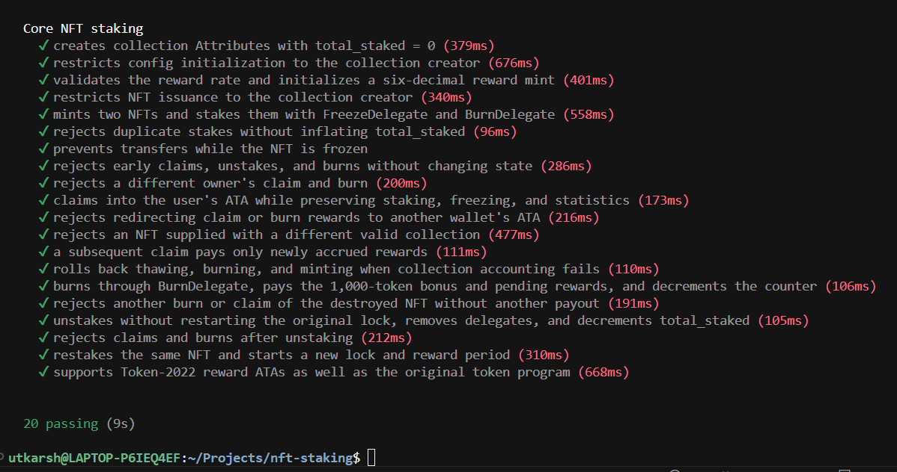

# NFT Staking Core

A Solana NFT staking program built with Anchor and Metaplex Core.

## Features

- **Claim rewards:** collect tokens in your ATA while the NFT stays staked and frozen.
- **Burn to earn:** permanently burn a staked NFT through BurnDelegate for **1,000 reward tokens**, plus pending rewards.
- **Collection stats:** `total_staked` is stored in the Collection's Attributes plugin and updated on stake, unstake, and burn.
- **Unstake and restake:** receive pending rewards and regain control of the NFT after the lock expires.

## Run tests

Requires installed Rust, Anchor, Solana, Node.js, and Surfpool.

```bash
npm ci
anchor test --skip-deploy
```

Tests run in a local VM. Surfpool needs internet access to read the Metaplex Core program from mainnet.

For Rust unit tests:

```bash
npm run test:unit
```

## Test results

**20 integration tests passing.** Coverage includes rewards, burns, collection counters, permissions, invalid accounts, lock periods, restaking, and transaction rollback.


